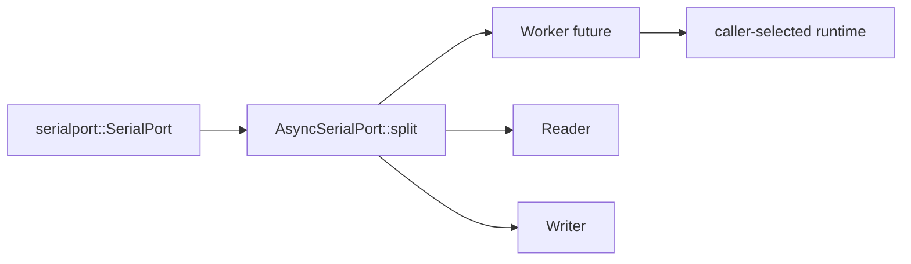
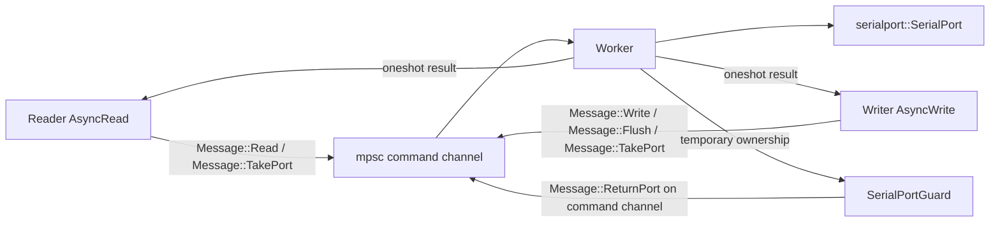

# Architecture

`async-serialport` separates the async API from the blocking serial-port API.
The async halves communicate with a worker future that owns the serial port and
executes the blocking operations.

## Components

- `Reader<T>` implements `tokio::io::AsyncRead` and can temporarily request the
  worker's concrete serial port.
- `Writer<T>` implements `tokio::io::AsyncWrite` and can make the same request.
- `AsyncSerialPort` is the public extension trait that creates the async halves
  and worker future.
- `Worker<T>` is the explicit future type returned by `split`, owns the serial
  port, and receives internal `Message` commands.
- `SerialPortGuard<T>` provides temporary mutable access and returns the port to
  the worker when dropped.
- `Message<T>` defines the internal read, write, flush, and take-port protocol.

## Construction Flow

Callers call `AsyncSerialPort::split` on an opened serial port. The trait
implementation creates the worker and returns the async halves plus the worker
future. Callers spawn that future on their runtime of choice.

## Message Flow

Each request sent to the worker contains a one-shot response channel. The async
half stores both the command-send future and the response receiver until the
operation completes.

## Read Path

1. `Reader::poll_read` creates a zeroed `BytesMut` sized to the caller's
   remaining `ReadBuf` capacity.
2. `Reader` sends that buffer to the worker in `Message::Read`.
3. The worker checks the number of bytes available on the serial port.
4. The worker reads at most the smaller of the available byte count and the
   provided buffer length.
5. The worker truncates the `BytesMut` to the actual read count, freezes it, and
   returns it through the response channel.
6. If the returned `Bytes` is empty, `Reader` keeps the read pending and sends
   another read request instead of completing the caller's read.
7. Otherwise, `Reader` copies the returned bytes into the caller's `ReadBuf`.

## Write Path

1. `Writer::poll_write` copies the caller's buffer into `Bytes`.
2. The writer sends `Message::Write` to the worker.
3. The worker writes the full buffer to the serial port.
4. The writer returns the accepted byte count after the worker reports success.

Flush and shutdown use the same request/response structure with
`Message::Flush`.

## Temporary Ownership Path

1. `Reader::take_serial_port` or `Writer::take_serial_port` sends
   `Message::TakePort` with a one-shot response channel.
2. The worker reserves the bounded command channel's additional return slot,
   removes the concrete port from its `Option<T>`, constructs the guard, and
   sends that guard to the requester. If the requester is cancelled before
   receiving it, dropping the queued or rejected guard returns the port.
3. `SerialPortGuard<T>` owns the port and dereferences mutably to `T`. It also
   owns a permit for the bounded command channel's reserved return slot.
4. Dropping the guard uses that permit to send `Message::ReturnPort` through the
   same command channel without blocking or failing because the channel is full.
5. The worker restores the returned port. A later take request reserves the
   return slot again before ownership leaves the worker.

## Failure Modes

If the worker command channel or a response channel closes while an operation is
pending, the async half reports `std::io::ErrorKind::BrokenPipe`. Serial-port
operation failures are forwarded as `std::io::Error` values.

While `SerialPortGuard<T>` owns the port, read, write, flush, and competing
take-port commands receive `std::io::ErrorKind::NotConnected`. Once the guard is
dropped, commands resume against the same port value.

The worker future itself returns the owned serial port after all command senders
are dropped. A guard retains a sender until its drop path has returned the port.
Failed ordinary I/O response sends are ignored because they mean the requesting
async half no longer waits for the result.
